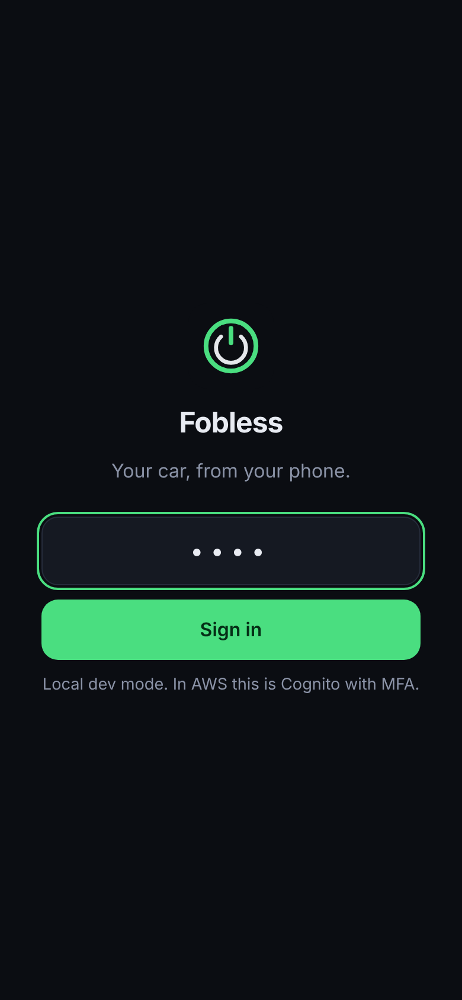
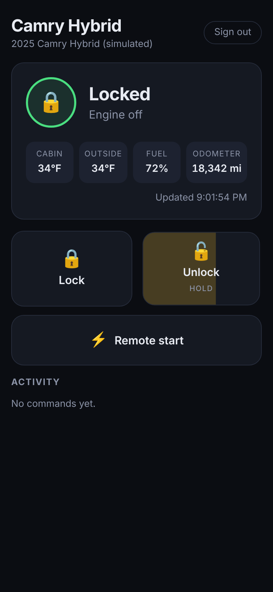
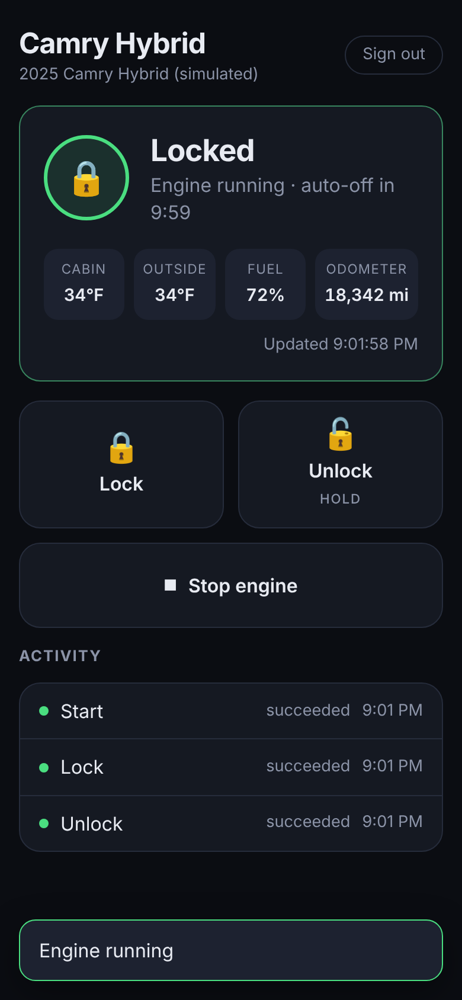
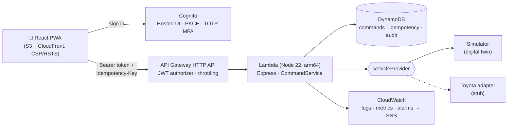

# Fobless

Lock, unlock and remote-start a car from your phone. Built around a Camry Hybrid, and designed so the part that talks to the car is swappable.

React PWA on the front, Node.js on AWS Lambda behind API Gateway, Cognito for identity, DynamoDB for the audit trail. Everything is in CDK.

| Sign in | Hold to unlock | Remote start |
|---|---|---|
|  |  |  |

## Why this isn't "just call an API"

Unlocking a car is a security problem first and a CRUD app second. Most of the code here is about what happens when things go wrong:

- **A retry must never fire a command twice.** Every tap generates an `Idempotency-Key`. Network retries reuse it, and the backend claims the key atomically in DynamoDB (a transactional conditional write). Reusing a key for a *different* command is rejected with a 409.
- **A valid session is not enough to unlock.** Unlock requires a sign-in from the last 5 minutes (checked against the token's `auth_time`). Older session? You get a `step_up_required` and re-authenticate with MFA. Locking never needs this; you should always be able to lock your car.
- **Pocket-proof UI.** Unlock is press-and-hold, not tap.
- **Owner allowlist.** Cognito is invite-only with TOTP MFA required, and the API additionally checks the caller's `sub` against the owner list. A deploy with no owner configured denies everyone.
- **Rate limiting at two layers.** API Gateway stage throttling, plus a per-user command limit in the service (6/minute) that stops a stolen token or a buggy client from hammering the car.
- **Audit everything.** Every command, including blocked ones, is recorded with user, IP, user agent and outcome, retained 90 days via DynamoDB TTL. Structured JSON logs feed CloudWatch metric filters and alarms ("3 blocked commands in 5 minutes" is a signal worth waking up for).

The full write-up is in [docs/threat-model.md](docs/threat-model.md).

## Architecture



The backend never talks to a car directly. It talks to a `VehicleProvider`:

```ts
interface VehicleProvider {
  listVehicles(): Promise<VehicleSummary[]>;
  getStatus(vin: string): Promise<VehicleStatus>;
  sendCommand(vin: string, command: "lock" | "unlock" | "start" | "stop"): Promise<void>;
}
```

- **`SimulatedVehicleProvider`** (default) is a small digital twin: lock state, a 10-minute remote-start window with auto-shutoff, cabin temperature warming toward 70°F, configurable latency and failure rate. Like the real car, it refuses remote start while the doors are unlocked.
- **`ToyotaConnectedProvider`** is a deliberate stub. Toyota has no public API for its connected services. The community has reverse-engineered the official app's backend, but it's undocumented, changes without notice, and using it is very likely outside Toyota's terms. So this repo ships the seam and the contract, not the endpoints. Drop in an integration you're entitled to use and nothing else changes.

## Run it locally

Requires Node 22.

```bash
# API on :8787
cd backend
cp .env.example .env        # set DEV_PIN and DEV_JWT_SECRET
npm install
npm run dev

# App on :5173 (proxies /api to the backend)
cd ../frontend
npm install
npm run dev
```

Open http://localhost:5173 and sign in with your `DEV_PIN`. Set `SIMULATOR_FAILURE_RATE=0.3` to watch the error handling work.

```bash
cd backend && npm test      # 16 tests: auth, idempotency, step-up, rate limits, audit, simulator
```

## Deploy to AWS

```bash
cd frontend && npm run build
cd ../infra && npm install
npx cdk bootstrap            # once per account/region
npx cdk deploy -c alertEmail=you@example.com
```

The stack outputs the app URL and a ready-made `admin-create-user` command. Then:

1. Create your user with that command, sign in once, and enroll an authenticator app (MFA is mandatory).
2. Get your `sub` from the Cognito console (or `aws cognito-idp admin-get-user`).
3. Redeploy with `npx cdk deploy -c ownerUserId=<your-sub>`. Until you do, the API denies every command.

Cost for one person is effectively zero: Lambda, API Gateway, DynamoDB on-demand and Cognito all sit inside their free tiers at this volume. CloudFront and the SNS topic are cents.

## Design notes and trade-offs

- **Synchronous commands, 25s budget.** API Gateway HTTP APIs cap integrations at 30 seconds, so the Lambda waits up to 25s for the car to confirm. Real telematics can take longer. The next step is an async flow: return `202` with a command id, run the vendor call from a queue or Step Functions, and have the client poll `GET /api/commands/{id}` (the endpoint already exists).
- **No refresh tokens on the device.** Tokens live in `sessionStorage` and expire after an hour. Slightly annoying, much safer for something that opens your car.
- **AWS SDK not bundled.** The Lambda Node 22 runtime ships AWS SDK v3, so the DynamoDB store loads it at runtime and the deploy bundle stays small.
- **Defense in depth on tokens.** API Gateway's JWT authorizer validates the Cognito token, and the Lambda verifies it again (signature, issuer, `token_use`, `client_id`). If someone later adds a route and forgets the authorizer, it still fails closed.
- **Config at runtime, not build time.** CDK writes `config.json` next to the built app, so one frontend build works in every environment.

## Roadmap

- Scheduled warm-up ("weekdays at 7:40 if it's under 35°F") with EventBridge Scheduler
- Async command pipeline (SQS + Step Functions) for slow vendor APIs
- Passkeys (WebAuthn) for step-up instead of a full re-login
- Geofence: refuse unlock when the phone is more than N meters from the car

## Project layout

```
backend/    Express app, runs locally and on Lambda (serverless-http)
  src/commands/   CommandService: idempotency, step-up, rate limits, audit
  src/vehicles/   VehicleProvider interface, simulator, Toyota stub
  src/store/      In-memory and DynamoDB command stores
  src/auth/       Cognito JWT verification, local dev tokens
frontend/   React 19 + Vite PWA
infra/      AWS CDK stack
docs/       Threat model, screenshots
```
